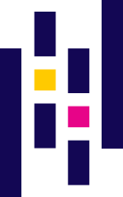

 <!--______________________________________________-->
<h1>
  { } Languages   
   
   
   
   
   
   
   
   
   
   
  
</h1>

<h1>
  ⚙️ Frameworks   
   
  
</h1>

<h1>
  📚 Libraries   
   
   
  
</h1>

<h1>
  🗄️ Databases   
   
   
   
  
</h1>

<h1>
  🛠️ Tools   
   
   
  <picture><source media="(prefers-color-scheme: dark)" srcset="icons/static/githubIcon(light).svg"><source media="(prefers-color-scheme: light)" srcset="icons/static/githubIcon(dark).svg"></picture> 
   
   
   
   
  
</h1>
<!--_____________________________________________________________-->
<h3 align=center>🔒 Copyright © 2026 Dante</h3>
