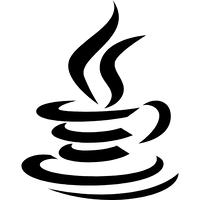
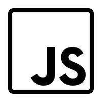
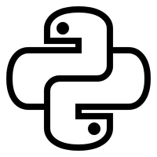
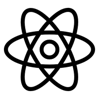

- 🔭 I’m currently working on feeding my 😾 graph
- 🌱 I’m currently learning 🐍|☕
- 👯 I’m looking to collaborate on projects that seem like a good idea at 2 AM
- 🤔 I’m looking for help with bug extermination
- 💬 Ask me about questionable project ideas
- 📫 How to reach me: carrier pigeon (or LinkedIn if the pigeon is on strike)
- 😄 Pronouns: 0/1
- ⚡ Fun fact: I spend more time naming variables than writing functions
___
<h1>💎Favourite Stack     Current Focus🚀</h1>
<h1>{ } Languages             </h1>
<h1>⚙️ Frameworks    </h1>
<h1>📚 Libraries     </h1>
<h1>🗄️ Databases      </h1>
<h1>🛠️ Tools     <picture><source media="(prefers-color-scheme: dark)" srcset="icons/static/githubIcon(light).svg"><source media="(prefers-color-scheme: light)" srcset="icons/static/githubIcon(dark).svg"></picture>     </h1>
