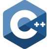

- 🔭 I’m currently working on feeding my 😾 graph
- 🌱 I’m currently learning 🐍
- 👯 I’m looking to collaborate on projects that seem like a good idea at 2 AM
- 🤔 I’m looking for help with bug extermination
- 💬 Ask me about questionable project ideas
- 📫 How to reach me: carrier pigeon (or LinkedIn if the pigeon is on strike)
- 😄 Pronouns: 0/1
- ⚡ Fun fact: I spend more time naming variables than writing functions
___
<h1>{ } Languages             </h1>
<h1>⚙️ Frameworks   </h1>
<h1>📚 Libraries</h1>
<h1>🗄️ Databases      </h1>
<h1>🛠️ Tools      </h1>
